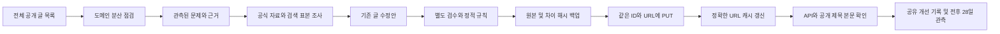

# 색인 및 트래픽 수집

코드는 두 곳에서 관리합니다. `metrics.py`는 수집과 요청, `metrics.js`는 화면 표시를 담당합니다. 채널 목록은 기존 `dashboard/data/growth.sqlite3`를 재사용합니다.

```powershell
python dashboard/metrics.py --collect
python dashboard/metrics.py --collect --read-only
python dashboard/metrics.py --collect --site daynote.kr
python dashboard/metrics.py --site daynote.kr --request-indexing https://www.daynote.kr/공개-슬러그
python dashboard/metrics.py --discover-indexnow --collect
python dashboard/metrics.py --recover-indexing --account sj
```

설정은 웹에서 제공되지 않는 `dashboard/data/metrics-config.json`에 둡니다. Google 서비스 계정 또는 OAuth authorized-user JSON 경로와 사이트별 속성을 지정합니다. 인증 파일은 `dashboard/`에 두지 않습니다.

```json
{
  "google_credentials": "C:/private/google-metrics.json",
  "sites": {
    "daynote.kr": {
      "gsc_property": "sc-domain:daynote.kr",
      "ga4_property": "실제 숫자 속성 ID",
      "sitemap_url": "https://www.daynote.kr/sitemap.xml",
      "indexnow_key": "소유확인 키",
      "indexnow_key_location": "https://www.daynote.kr/키.txt"
    }
  }
}
```

Google 인증 주체에 해당 Search Console 속성과 GA4 읽기 권한이 필요합니다. IndexNow는 실제 CF 도메인에서 키 파일 내용이 확인될 때만 요청합니다. 네이버 블로그 주소에는 이 방식을 적용하지 않습니다.

사이트별 `analytics_reader`가 지정되어 있으면 `analytics_readers`의 인증 파일·이메일을 검증한 뒤 읽기 전용 계정으로 URL Inspection과 GA4를 조회합니다. 색인 속성은 `gsc_property`, `search_property`, 도메인 속성 순으로 선택합니다. 실제 공개 URL의 www 주소까지 포함하는 속성 권한이 필요하며, 접근 거부는 미확인으로 남깁니다. 조회 계정을 사이트맵 제출 계정으로 대체하지 않습니다.

`--read-only`는 URL Inspection·공개 목록·통계만 조회하고 사이트맵 및 IndexNow 제출을 실행하지 않습니다. `--request-indexing`과 함께 사용할 수 없습니다. URL Inspection의 PASS는 색인 확인, FAIL 및 NEUTRAL(제외)은 미색인 확인으로 집계합니다.

수집 실행 시 새 공개 URL이 있거나 이전 요청이 미처리인 사이트를 다시 확인합니다. 인증과 소유확인이 준비되면 Google 사이트맵 및 네이버 IndexNow 요청을 처리합니다. 요청 완료 뒤 같은 URL 집합은 반복 제출하지 않습니다. 사이트별 `auto_submit: false`로 자동 제출을 끌 수 있습니다.

결과는 `dashboard/data/metrics.json`에 저장하며 `/api/metrics`에서 읽습니다. 자격 증명은 결과에 포함하지 않습니다. 요청 성공은 색인 완료가 아닙니다. URL Inspection은 URL별로 하루에 한 번, 실행당 도메인별 최대 10건을 확인합니다. 미확인 URL은 정상으로 집계하지 않습니다.

URL 검사는 미측정 글부터 오래된 공개 목록 순서로 진행합니다. API 속성 권한 오류(403)는 사이트당 한 번 확인한 뒤 6시간 API 재시도 대기를 적용합니다. API 권한 대기는 이미 로그인된 소유자 브라우저의 읽기 전용 검사까지 막지 않습니다. 실패 시각은 `attemptAt`, 성공 확인 시각은 `checkedAt`으로 분리하고, 실패가 과거 성공을 새 확인으로 바꾸지 않습니다.

`url_inspection.browser_accounts`의 SJ 소유자 브라우저는 별도의 읽기 전용 URL 검사를 수행합니다. 현재 설정은 30분 예약 수집 회차당 최대 36 URL·420초이며, 이는 이 프로젝트의 작업량 제한입니다. 계정·전용 브라우저 프로필을 검증하고 실제 검사 주소와 Google 판정이 일치할 때만 기록합니다. 사이트마다 번갈아 선택하는 커서를 저장하고 각 결과를 즉시 저장합니다. 수집 제한·계정 확인 요청이 나오면 계정 전체를 쉬게 하며, 트래픽 조회·복구 작업과 `gsc-ui-계정.lock`을 공유합니다. 새 검사 탭만 닫고 기존 탭과 로그인 상태를 유지합니다. 이 검사는 색인 생성 요청·실제 URL 테스트·사이트맵 제출을 누르지 않습니다.

`indexing.collection`은 최근 26시간 확인(`currentInspected`), 누적 실제 확인(`everInspected`), 오래된 확인(`staleInspected`), 최근 재검사 실패로 현재 판정이 없는 과거 확인(`unresolvedInspected`), 한 번도 성공 확인되지 않은 글(`neverInspected`)을 구분합니다. 현재 확인 + 오래된 확인 + 재검사 미확정 + 미측정 = 공개 목록입니다. `failed`는 검사 실패 수이며 미측정·재검사 미확정과 겹칠 수 있습니다. `inspectionAutomation`에는 실제 작업 상태·회차별 시도/완료·저장 커서·소요 시간·재시도 시각을 남깁니다. 처리 속도를 확인하기 전 전체 완료 시각이나 전체 색인율을 추정하지 않습니다.

Google 브라우저 요청은 설정의 `gsc_accounts`에 등록한 전용 CDP·이메일·사이트만 사용합니다. 활성 GSC 브라우저 수집은 SJ(9226, CF 15사이트)와 aaa10291028(9260, Nolplace)입니다. 2026-10-14 사용자 승인으로 기존 HealthCox·TripMarvel의 동일 www 속성에 `sj@must.biz` 전체 사용자 권한을 추가하고 SJ 실적 조회·URL 검사를 확인했습니다. 기존 mustbiz06 소유자 및 서비스 계정 권한, 속성 이력·사이트맵은 유지합니다. 두 사이트의 API `analytics_reader`는 정상 조회되는 기존 mustbiz06 설정을 그대로 사용하며, 브라우저 수집 경로만 SJ로 통일합니다. mustbiz06 원소유 속성은 `retained_owner_sites`에 기록합니다. 프록시 계정은 현재 전용 배치 설정과 일치하는 출구 IP를 확인합니다. Flow용 baro76650(9420)을 색인 계정으로 대체하지 않습니다.

브라우저 복구는 사이트맵 전체 URL 포함 여부를 확인한 뒤 재제출하고, 최근 공개 URL을 번갈아 검사하여 로컬 운영 한도인 계정별 하루 최대 10건을 개별 요청합니다. 이는 Google의 고정 공식 할당량으로 주장하는 값이 아닙니다. 요청 이력은 `dashboard/data/indexing-recovery.json`에 남기며, 중복 실행·최근 요청 재제출·확인되지 않은 접수를 차단합니다. 브라우저는 종료하지 않습니다.

`--discover-indexnow`는 기존 CF 사이트 관리자 API에서 해당 사이트의 키를 읽고 공개 키 파일을 대조합니다. 사이트 설정이나 원고를 변경하지 않습니다. 인증 실패 또는 키 파일 404는 보류 사유로 기록합니다.

GA4는 도메인으로 필터링한 최근 7일(원천 시간대의 8일 전부터 2일 전)을 읽습니다. 서로 다른 기간·시간대의 값을 합치지 않으며, 임계값 제한이나 표본 데이터는 부분 수집으로 표시합니다. 네이버 출처 세션은 계정별 브릿지 클릭수와 구분합니다. 네이버 자체 방문자 통계와 수익은 원천 연결 전까지 미수집입니다.

인증 설정이 없더라도 공개 CF 글 목록과 사이트맵을 점검합니다. `BaroLab-Metrics-Collector` 작업은 서버를 띄우지 않고 주기적으로 이 명령만 실행합니다.

공식 규격: [Google 사이트맵 제출](https://developers.google.com/webmaster-tools/v1/sitemaps/submit), [URL Inspection](https://developers.google.com/webmaster-tools/v1/urlInspection.index/inspect), [GA4 보고서](https://developers.google.com/analytics/devguides/reporting/data/v1/rest/v1beta/properties/runReport), [네이버 IndexNow](https://searchadvisor.naver.com/guide/indexnow-request).

## AdSense 계정과 사이트 수익 범위

수익 계정은 `metrics-config.json`의 `adsense_accounts`로 관리하며 GSC 계정 소유 목록과 독립적입니다. 2026-10-14 공식 API 확인 기준 SJ(`sj@must.biz`)에 CF 15개가 등록되어 있으며 기존 13개는 READY, HealthCox·TripMarvel은 소유 확인 및 검토 요청을 마친 GETTING_READY(심사 중·승인 전)입니다. 두 사이트의 광고 코드와 ads.txt는 SJ로 전환했습니다. Nolplace는 가족 aaa 계정 소속으로 별도 유지합니다. 이 AdSense 변경으로 GSC의 mustbiz06 소유 목록을 변경하지 않습니다.

수집기는 각 계정의 `env_prefix`에 해당하는 기존 AdSense OAuth 네 값만 사용합니다. 가족 aaa의 GA4/GSC 서비스 계정 인증은 AdSense OAuth로 대신 사용하지 않습니다. OAuth 미연결은 미수집이고 0달러가 아닙니다. 공식 sites.list에서 현재 등록 상태를 조회하며, 수익 보고서의 실제 관측 날짜만 합산합니다. 계정 변경은 과거 수익의 소급 귀속을 바꾸지 않습니다.
# 성장 비교와 개선 기록

성장 진단은 양기간에 실제 존재하는 동일 글·검색어 행만 매칭합니다. API는 query+page 차원의 실제 연결을 사용하고, 소유자 화면은 도메인 검색어와 글 필터 검색어를 구분합니다. 글 필터 조회는 회차 최대 1개 글이며 실제 행 클릭으로 생긴 필터 URL, 속성·계정·정확한 날짜를 확인한 경우에만 연결 근거로 저장합니다. 상위 일부 행의 누락을 0이나 신규 발행으로 해석하지 않고 전체 기여율도 만들지 않습니다. 노출/CTR 분해는 클릭 차이와 일치하는 산술 항등식이며 원인 증명이 아닙니다.

추가 소유자 성장 보고는 회차 최대 4개 도메인을 커서로 순환합니다. 원천 결과는 도메인·기간별로 즉시 원자 저장되어 작업 시간 제한 시 이미 얻은 근거가 남습니다. 운영 화면은 수집 시도·실제 성공·캐시·대기를 구분합니다. Google UI HTTP 429는 `gsc-ui-state.json`의 계정 공통 대기를 모든 조회 경로가 준수합니다. Retry-After가 없으면 6시간부터 시작해 연속 제한 시 최대 24시간까지 늘리며, 대기 종료 후 실제 확인 성공 시만 연속 제한 횟수를 초기화합니다. 다른 계정·브라우저로 우회하지 않습니다.

검색 성장 비교는 Google Pacific 기준 완료일에서 3일을 뺀 종료일의 최근 28일과 이전 28일을 별도로 조회합니다. 속성 합계는 글·검색어 행의 합계로 대체하지 않습니다. 정확한 날짜, 수집 26시간 이내, 전체 기간이 확인된 경우만 검색 비교가 가능합니다. 정상 조회의 0은 표시하지만 미수집·오류·기간 부족은 null입니다.

기존 30분 traffic 수집에서 28일 비교창을 자동 갱신하며 같은 날짜의 비교창은 12시간 캐시합니다. 완료된 공유 개선 기록은 완료일 전 28일과 완료일 다음날부터 28일의 글별 보고서를 별도 수집합니다. 미래의 후속 기간은 관찰 중으로 표시합니다. 추가 조회는 도메인별 회차 최대 2개 창이며 저장된 커서로 순환하므로 오래된 기록도 조회 대상에 남습니다. 발행이나 색인 요청은 하지 않습니다.

수익은 같은 Pacific 날짜의 AdSense 실제 DOMAIN_CODE 보고서이며, 일별 누락이나 계정 변경으로 범위가 불완전하면 확인분만 표시하고 증감 비교를 하지 않습니다. AdSense 페이지뷰는 광고 측 페이지뷰이며 GA 전체 페이지뷰와 다릅니다. 전후 변화만으로 개선의 인과효과를 주장하지 않습니다.

## 기존 콘텐츠 자동 점검과 개선

기본 점검 완료(`audit_checked`)는 구조와 접근 확인이며 사실이나 답변 완전성을 검증했다는 뜻이 아닙니다. 일일 조사 4회 중 1회를 전체 목록의 심층 근거 점검에 예약하고, 아직 심층 점검하지 않은 글과 오래된 글을 순환합니다. 이 회차는 자료와 연구 결과를 확인할 뿐 수정안·검수·원격 적용을 실행하지 않습니다. 확인된 문제 없이 글을 다시 쓰지 않으며, 원문 버전이 바뀌면 이전 심층 점검은 새 글에 적용하지 않습니다. `deepReviewPending`은 불량 글 개수가 아닌 미확인 범위입니다.

모든 원격 PUT와 정확한 URL 캐시 갱신은 canary 여부와 관계없이 enabled 설정을 즉시 재확인합니다. 명시적인 로컬 `--apply-job`도 enabled 중지 설정을 우회하지 않습니다. 중단된 적용이 미확인으로 남아 있으면 새 원격 수정을 진행하지 않습니다.

`common/content_maintenance.py`는 공개 URL 목록 전체를 기존 `growth.sqlite3`의 작업 목록으로 등록합니다. 목록 등록 수는 점검 완료 수가 아닙니다. 새로 발행되어 metrics 목록에 들어온 URL도 다음 회차에 추가합니다. 미점검 글과 오래된 점검을 도메인별로 분산해 회차 최대 10개, 약 40초 예산으로 원문/API/공개 페이지를 읽습니다. 접근 실패는 미확인으로 남고 다음 순회에서 재점검합니다. 실제 구조 문제와 조사 신호는 구분하며 노출이 없다는 이유로 불량 콘텐츠나 수익 0으로 판정하지 않습니다.



실행은 기존 CF cleaner 정상 종료 후 유휴 확인을 통과한 경우에만 별도 보조 프로세스를 시작합니다. 신규 예약 작업은 추가하지 않습니다. 보조 프로세스는 OS 파일 잠금으로 중복을 막고 580초 상한을 가집니다. 통계 작업이 실행 중이거나 CF/네이버 준비·공개 시각 10분 이내이거나 발행 잠금이 사용 중이면 양보합니다. 적용 직전에도 실제 잠금과 최신 원문 버전을 재확인합니다. 심층 조사는 30분 간격·일 최대 4회, 원격 수정 시도는 초기 일 최대 1개이며 이후 28일은 동일 글을 재수정하지 않고 관측합니다. 전체 저비용 점검은 수정 상한이나 모델 대기 중에도 계속합니다.

운영 enabled는 점검·조사를 허용하는 설정이고 실제 수정 준비 상태는 `writeReadiness`로 별도 표시합니다. 실측 문제, 독립 검수 통과, 최신 원천, 백업·차이·검수 해시가 모두 확인된 첫 후보는 동일 조건으로 한 건의 자동 canary를 수행합니다. 실제 공개 확인 성공 후만 canary 자격을 확인합니다. 모델 제한 중에는 후보를 꾸며내거나 임의 공급자로 우회하지 않고 공급자 대기 시각을 지킵니다. enabled 중지는 자동 canary에도 적용 직전 재확인됩니다. 명시적인 로컬 `--prepare-only`는 수정하지 않으며, `--apply-job ID`는 이미 검수된 단일 후보를 검증하는 운영자 실행입니다.

정책은 `content-maintenance-policy.json`에 별도로 저장해 서버의 중지 설정이 작업 런타임 저장과 경쟁하지 않게 합니다. 런타임·공급자 대기·실제 launch PID는 `content-maintenance.json`, 원본/수정안/차이/단계 영수증은 비공개 `maintenance-backups/<job-id>/`에 저장합니다. 성공한 버전은 해시별 하위 폴더에 보존합니다. 웹 API에는 공개 근거, 해시, 제한된 차이 요약만 반환하며 키나 백업 파일을 정적으로 제공하지 않습니다.

CMS는 수정할 때 제목을 기반으로 URL을 바꿀 수 있으므로 원래 slug를 반드시 보냅니다. 생성 API는 사용하지 않습니다. 기존 API가 예약 발행 시각을 보존하지 못하는 글은 자동 수정에서 보류합니다. 동일 글의 관리자 화면과의 원격 원자 CAS는 지원되지 않아 보장은 공유 잠금을 사용하는 관리 작업 범위에 한정됩니다. 최신 GET과 전체 보호 필드 비교 및 공개 확인을 사용하며, 실패 시 기대 버전과 일치할 때만 원본으로 복구합니다. 다른 작업의 메타 정보 변경도 덮어쓰지 않습니다. 중단된 PUT는 다음 회차에서 읽기와 공개 확인으로 조정하며 맹목적으로 재전송하지 않습니다. 실제 공개 확인된 완료만 공유 성장 기록에 완료로 넣고 후속 정확한 28일 보고서를 수집합니다.

